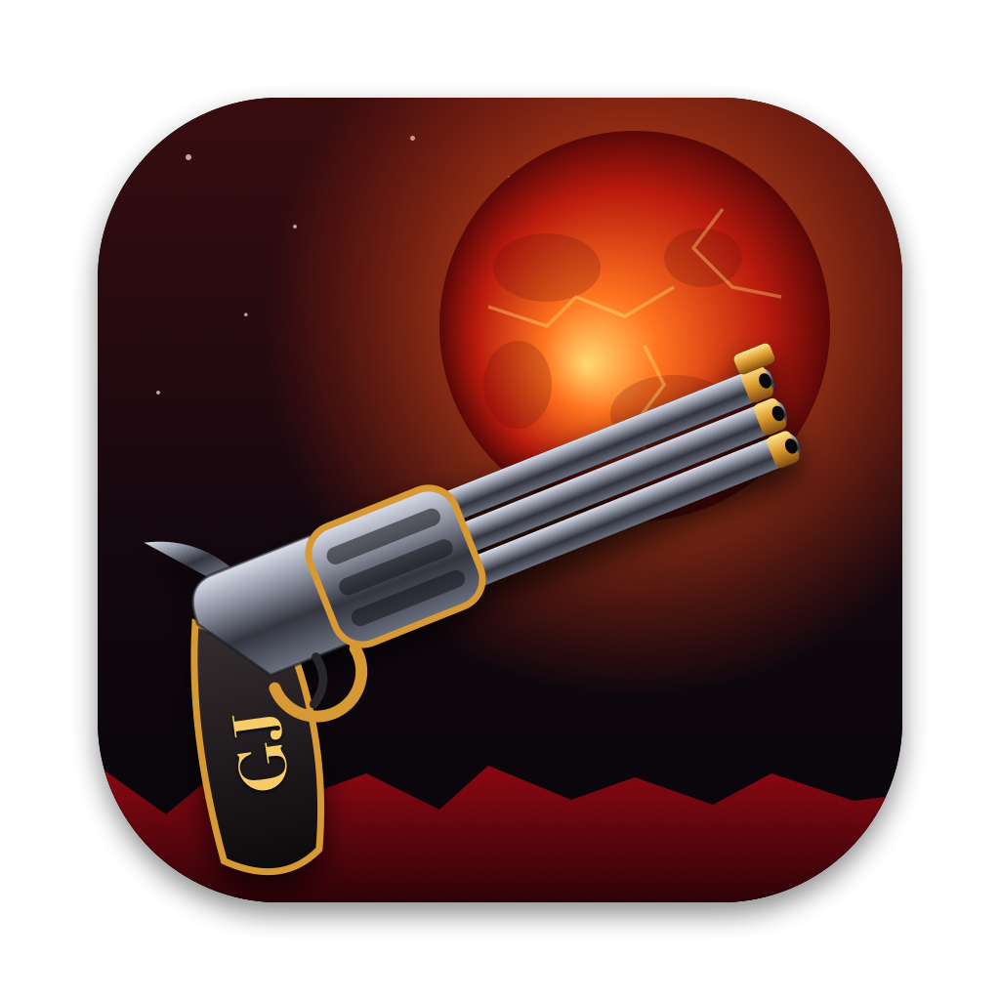
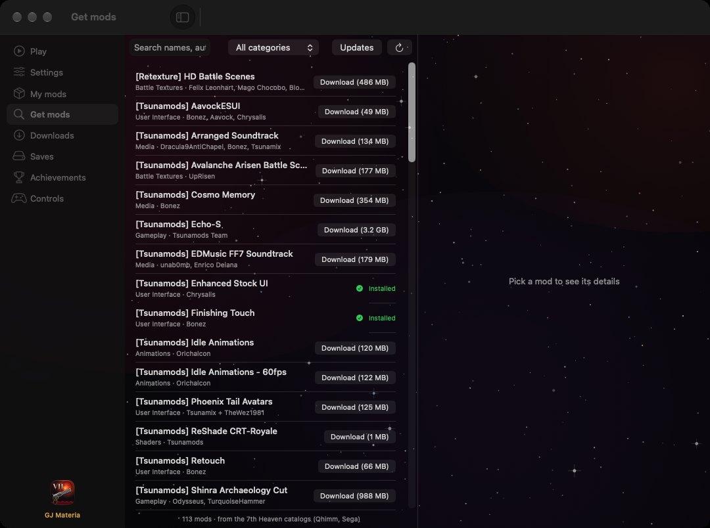
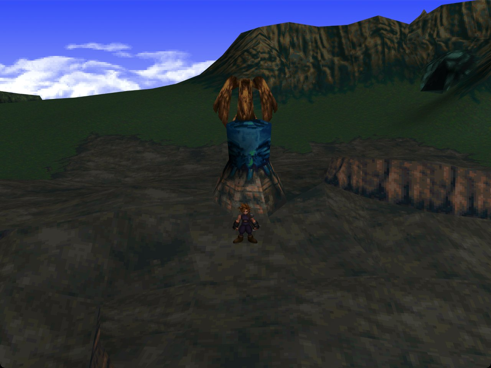
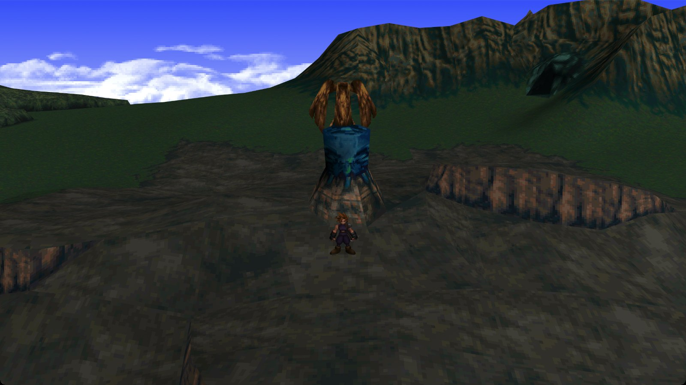

<p align="center"></p>

<h1 align="center">GJ Materia</h1>

<p align="center"><b>FINAL FANTASY VII (Steam) as a native Mac app, with a 7th Heaven-style mod manager.</b><br>
by <a href="https://github.com/goodjoeth">Good JOE</a> · the macOS port of
<a href="https://github.com/bhuiyah/ff7-recomp-android">FF7Recomp</a></p>

> **This repository contains no game code or data.** You need your own copy of FINAL FANTASY VII
> from Steam. The build script translates **your** `ff7_en.exe` and compiles it on **your** Mac;
> nothing derived from the game is ever published. Do not share the built app: it contains code
> derived from the game. Not affiliated with or endorsed by Square Enix.

<p align="center">
  
  
  
  
</p>

[ภาษาไทยด้านล่าง](#ภาษาไทย)

## What you get

- The game runs natively: no Wine, no CrossOver. The game's code was statically recompiled to C;
  graphics are FFNx on Metal. (It is built as an Intel app and runs under Rosetta 2 on Apple
  silicon: the recompiled code keeps the game's 32-bit memory layout, which only Intel processes
  may use on macOS.)
- A launcher in English or Thai: settings (4:3, 16:9, 16:10, **21:9**, resolution, 30/60/120 FPS, CRT filter,
  NTSC-J colours, controller rumble, game boosters), 7th Heaven catalogs with downloads, a mod
  library with 7th Heaven's Configure Mod (option previews), save import/export (PC saves,
  DuckStation / RetroArch / ePSXe memory cards), save states, achievements (offline set, and
  Steam achievements by QR sign-in), playing on any display (an AirPlay display used as a
  separate display, a TV, a second monitor).
- Keyboard and controllers (Xbox, PlayStation, MFi). With a controller the launcher switches to a
  TV mode (big tiles, D-pad and A/B); Select+Start held for 2 seconds (or Cmd+L) leaves the game
  for the launcher. F1 (or Select+Triangle) shows the achievements over the game; Cmd+Shift+A
  opens them in a window of their own.
- iCloud saves: saves and save states in iCloud Drive/FF7Recomp, so every Mac on the Apple ID
  continues the same game (a backup before each Play, and a warning when another Mac is playing).
- Report a problem: one .zip with the logs, settings and mod list (no game files, no Steam
  sign-in), to attach to a bug report.

## Screen shapes

The same spot on the world map in each shape the game can take. Widescreen shows more of the world
instead of stretching it (FFNx's widescreen, extended here to 21:9).

| 4:3 (original) | 16:9 | 21:9 |
|:---:|:---:|:---:|
|  |  |  |

At 21:9 the mods' battle windows are laid out for 16:9; Settings chooses where the status window
(HP/MP) sits:

| Where 16:9 has it (default) | Halfway out | At the screen edge |
|:---:|:---:|:---:|
|  |  |  |

## Why it runs natively, and what that saves you

Wine, CrossOver, Whisky and the kits built on them run the Windows game as it is: every Windows
call goes through a re-implementation of Windows, Direct3D is translated to Metal on the fly
(often twice: Direct3D to Vulkan to Metal), and the 32-bit game needs Wine's 32-on-64-bit
bridge. That is where the stutters, freezes, black screens and broken movies come from, and
why each macOS or Wine update can break it.

GJ Materia does the translation once, ahead of time, on your Mac:

1. **The game's code becomes C.** A static recompiler (pcrecomp) reads your `ff7_en.exe` and
   writes every function of it as C source; clang compiles that into the app. Nothing is
   interpreted or emulated while you play.
2. **No Windows underneath.** The few Windows calls the game makes (files, timers, sound, input,
   windows) are answered by a small layer written for the Mac: files go straight to the disk,
   sound to Core Audio, controllers through Apple's Game Controller framework, the window is a
   normal Mac window.
3. **Graphics straight to Metal.** FFNx, the renderer the PC modding community uses, draws
   through bgfx's Metal backend: no Direct3D, no Vulkan, no translation layer.
4. **Mods without Windows.** 7th Heaven's catalogs, mod options and code patches (hext) are
   handled by the launcher itself; mods that patch the game's code can be lifted into the app too
   ("Make mods faster") so they run natively as well.

What that gives you: a steady 60 FPS with even frame pacing, no shader-translation hitches, quick
start-up, the Mac's own fullscreen, Retina resolution, rumble on Mac controllers, AirPlay to a TV,
iCloud saves, and nothing to configure (no bottles, prefixes or DLL overrides).

One honest note: the app is built for Intel and runs under Rosetta 2 on Apple silicon. The
recompiled code keeps the game's 32-bit memory layout, which macOS only allows Intel processes.
Rosetta translates the whole app once, ahead of time, so this costs little; it is not the
run-time Windows emulation Wine does.

## First: your game files

You need FINAL FANTASY VII **bought on Steam** (the release sold today). Its files are the Windows
version; get them onto the Mac one of these ways:

- **A Windows PC:** Steam > right-click the game > Manage > Browse local files, and copy the
  whole `FINAL FANTASY VII Steam Edition` folder (about 3.5 GB) to the Mac (Downloads or an
  external drive is fine).
- **CrossOver or Whisky on the Mac:** install Windows Steam in a bottle, then FF7.
- **steamcmd on the Mac** (Valve's command-line Steam; it asks for your password and Steam Guard
  code in the Terminal):
  ```bash
  mkdir -p ~/steamcmd && cd ~/steamcmd
  curl -sqL "https://steamcdn-a.akamaihd.net/client/installer/steamcmd_osx.tar.gz" | tar zxf -
  ./steamcmd.sh +@sSteamCmdForcePlatformType windows +force_install_dir ~/FF7 +login YOUR_STEAM_LOGIN +app_update 3837340 validate +quit
  ```

The build script and the launcher find the folder by themselves in all of these places (and on
external drives); you can also point them at it.

## Install (the easy way)

1. Get your game files (above).
2. Download **GJ-Materia-Installer.zip** from [Releases](https://github.com/goodjoeth/gj-materia/releases),
   unzip it, and open **GJ Materia Installer**. The first time, macOS may say it can't check the
   developer: right-click the installer, choose **Open**, then **Open** again.
3. Press **Install**. It sets up Apple's Command Line Tools and Rosetta 2 if missing (macOS asks
   you to confirm), fetches the build tools into its own folder (no Homebrew needed), finds your
   game, downloads this source and builds GJ Materia on your Mac (20-40 minutes the first time),
   then puts it in Applications.

The installer contains no game code and downloads none: the game's code is translated from your
own copy, on your Mac. Use the Mac's own drive or one formatted APFS / Mac OS Extended (exFAT
drives don't work for the build); about 15 GB free.

## Build (by hand)

Needs macOS 13 or later, about 15 GB free and 20-30 minutes the first time.

1. Get your game files (above).
2. Install the tools:
   ```bash
   xcode-select --install
   brew install cmake ninja
   python3 -m pip install --user capstone
   softwareupdate --install-rosetta --agree-to-license   # Apple silicon
   ```
3. Get this source and build:
   ```bash
   git clone https://github.com/goodjoeth/gj-materia.git
   cd gj-materia
   bash tools/build_mac.sh            # finds the game; or pass its folder
   ```
4. Open `build/macos/GJ Materia.app`. On the Play page, **Find FF7 on this Mac** and **Import**
   (once: the game files are copied into the app's folder), then **Play**.

Keep the source folder: **My mods > Make mods faster** re-lifts the enabled mods' code patches
from it (about 5-10 minutes) so they run natively.

Technical notes: [docs/MACOS.md](docs/MACOS.md). The Android version this is ported from:
[README_ANDROID.md](README_ANDROID.md).

## Credits

GJ Materia was put together by Good JOE, with an AI coding agent (Claude, in Claude Code) writing
the code under his direction, as the Android version was.

FF7Recomp and its Android port; [FFNx](https://github.com/julianxhokaxhiu/FFNx);
[pcrecomp](https://github.com/sp00nznet/pcrecomp); 7th Heaven and the Qhimm / Tsunamods
catalogs; bgfx, FFmpeg, SDL, rcheevos and the other libraries in `tools/fetch_deps*.sh`; and every
mod author. Please support them. Licensed under the GNU GPL v3 (see LICENSE), as FF7Recomp and FFNx.

---

## ภาษาไทย

FINAL FANTASY VII (เวอร์ชัน Steam) เป็นแอป Mac แบบ native พร้อมตัวจัดการม็อดแบบ 7th Heaven

> **repo นี้ไม่มีโค้ดหรือไฟล์ของเกม** ต้องมี FINAL FANTASY VII จาก Steam ของตัวเอง สคริปต์จะแปลง
> `ff7_en.exe` **ของคุณ** และ compile บน Mac **ของคุณ** เท่านั้น **ห้ามแชร์แอปที่ build แล้ว** เพราะมีโค้ดที่แปลงมาจากเกม
> ไม่เกี่ยวข้องกับ Square Enix

### ได้อะไร
- เกมรันแบบ native ไม่ใช้ Wine/CrossOver (โค้ดเกมถูกแปลงเป็น C ภาพผ่าน FFNx บน Metal แอปเป็น Intel และรันผ่าน Rosetta 2 บน Apple silicon)
- Launcher ภาษาอังกฤษหรือไทย (เปลี่ยนได้ในหน้าตั้งค่า): ตั้งค่า (4:3, 16:9, 16:10, **21:9**, ความละเอียด, 30/60/120 FPS, ฟิลเตอร์ CRT, สี NTSC-J, การสั่นของจอย, ตัวช่วยเล่น), ค้นหาและดาวน์โหลดม็อดจาก catalog ของ 7th Heaven, จัดการม็อดพร้อมภาพตัวอย่างตัวเลือก, นำเข้า/ส่งออกเซฟ (PC, memory card ของ DuckStation/RetroArch/ePSXe), save state, achievement (ออฟไลน์ และ Steam ผ่าน QR), เลือกจอที่เล่น (รวม AirPlay แบบจอแยก)
- คีย์บอร์ดและจอย Xbox / PlayStation / MFi กดปุ่มจอยใน launcher จะเข้าโหมดทีวี (ใช้จอยล้วน) กด Select+Start ค้าง 2 วินาที (หรือ Cmd+L) ในเกมเพื่อกลับ launcher กด F1 (หรือ Select+△) ดู achievement ทับบนเกม หรือ Cmd+Shift+A เปิดเป็นหน้าต่างแยก
- เซฟ iCloud: เก็บเซฟและ save state ใน iCloud Drive/FF7Recomp ทุก Mac ที่ใช้ Apple ID เดียวกันเล่นต่อกันได้ (สำรองเซฟทุกครั้งที่กดเล่น และเตือนเมื่อมีอีกเครื่องเปิดเกมอยู่)
- ปุ่มรายงานปัญหา: รวม log ตั้งค่า และรายการม็อดเป็นไฟล์ .zip เดียว (ไม่มีไฟล์เกมและข้อมูลบัญชี Steam)

### ทำไมถึงเป็น native และช่วยลดปัญหาอะไรจากการใช้ Wine / CrossOver
Wine, CrossOver, Whisky และชุดที่สร้างบนพวกนี้ รันเกม Windows ตามเดิม ทุกคำสั่งของ Windows ต้องผ่านตัวจำลอง Windows, Direct3D ถูกแปลงเป็น Metal ระหว่างเล่น (หลายครั้งแปลงสองชั้น Direct3D → Vulkan → Metal) และเกม 32 บิตต้องผ่านสะพาน 32-on-64 ของ Wine จึงเกิดอาการกระตุก ค้าง จอดำ ภาพยนตร์ในเกมไม่เล่น และพังได้ทุกครั้งที่อัปเดต macOS หรือ Wine

GJ Materia แปลงครั้งเดียวล่วงหน้าบน Mac ของคุณ:
1. **โค้ดเกมกลายเป็นภาษา C** ตัว static recompiler อ่าน `ff7_en.exe` ของคุณแล้วเขียนทุกฟังก์ชันออกมาเป็นซอร์ส C แล้ว compile เข้าแอป ระหว่างเล่นไม่มีการจำลองหรือแปลโค้ด
2. **ไม่มี Windows อยู่ข้างใต้** คำสั่ง Windows ไม่กี่อย่างที่เกมใช้ (ไฟล์ เวลา เสียง จอย หน้าต่าง) ตอบด้วยโค้ดที่เขียนสำหรับ Mac โดยตรง: เสียงไป Core Audio, จอยผ่าน Game Controller ของ Apple, หน้าต่างเป็นหน้าต่าง Mac ปกติ
3. **ภาพส่งตรงไป Metal** ผ่าน FFNx (ตัว render ที่ชุมชนม็อด PC ใช้) บน bgfx Metal ไม่มี Direct3D ไม่มี Vulkan ไม่มีชั้นแปลง
4. **ม็อดไม่ต้องพึ่ง Windows** launcher จัดการ catalog ตัวเลือก และ code patch (hext) ของ 7th Heaven เอง ม็อดที่แก้โค้ดเกมก็ lift เข้าแอปให้รันแบบ native ได้ ("ทำให้ม็อดเร็วขึ้น")

ผลที่ได้: 60 FPS นิ่ง จังหวะเฟรมสม่ำเสมอ ไม่กระตุกจากการแปลง shader เปิดเร็ว เต็มจอแบบ Mac ความละเอียด Retina จอยสั่นได้ AirPlay ขึ้นทีวี เซฟ iCloud และไม่ต้องตั้งค่า bottle, prefix หรือ DLL ใดๆ

หมายเหตุตามจริง: แอป build เป็น Intel และรันผ่าน Rosetta 2 บน Apple silicon เพราะโค้ดที่แปลงมาใช้หน่วยความจำแบบ 32 บิตของเกม ซึ่ง macOS อนุญาตเฉพาะโปรแกรม Intel แต่ Rosetta แปลทั้งแอปครั้งเดียวล่วงหน้า เสียประสิทธิภาพน้อย ไม่ใช่การจำลอง Windows ระหว่างเล่นแบบ Wine

### เปรียบเทียบสัดส่วนจอและตำแหน่ง HUD
ภาพด้านบน (หัวข้อ Screen shapes): world map จุดเดียวกันที่ 4:3, 16:9 และ 21:9 (จอกว้างเห็นโลกมากขึ้น ไม่ได้ยืดภาพ) และฉากต่อสู้ที่ 21:9 กับตำแหน่งแถบ HP/MP สามแบบที่เลือกได้ในหน้าตั้งค่า

### ขั้นแรก: ไฟล์เกมของคุณ (ต้องทำก่อน)
ต้องซื้อ FINAL FANTASY VII **บน Steam** (เวอร์ชันที่ขายปัจจุบัน) ไฟล์เกมเป็นเวอร์ชัน Windows เอามาไว้ใน Mac ได้ 3 วิธี:
- **มีคอม Windows:** ใน Steam คลิกขวาที่เกม → Manage → Browse local files → ก๊อปโฟลเดอร์ `FINAL FANTASY VII Steam Edition` ทั้งโฟลเดอร์ (~3.5 GB) มาไว้ใน Mac
- **CrossOver หรือ Whisky บน Mac:** ติดตั้ง Steam เวอร์ชัน Windows ใน bottle แล้วติดตั้ง FF7
- **steamcmd บน Mac:** ใช้คำสั่งในส่วนภาษาอังกฤษด้านบน (Terminal จะถามรหัสผ่านและรหัส Steam Guard)

สคริปต์ build และ launcher จะค้นหาโฟลเดอร์เกมเองทุกที่ข้างบน รวมถึงไดรฟ์ภายนอก

### ติดตั้งแบบง่าย
1. เตรียมไฟล์เกม (ขั้นแรกด้านบน)
2. โหลด **GJ-Materia-Installer.zip** จากหน้า [Releases](https://github.com/goodjoeth/gj-materia/releases) แตกไฟล์แล้วเปิด **GJ Materia Installer** (ครั้งแรก macOS อาจเตือนว่าไม่รู้จักผู้พัฒนา ให้คลิกขวาที่ตัวติดตั้ง → Open → Open)
3. กด **ติดตั้ง** ตัวติดตั้งจะลง Command Line Tools และ Rosetta 2 ให้ถ้ายังไม่มี (macOS จะถามยืนยัน) โหลดเครื่องมือ build มาเก็บเอง (ไม่ต้องใช้ Homebrew) หาเกมให้ โหลดซอร์ส แล้ว build GJ Materia บน Mac ของคุณ (ครั้งแรก 20–40 นาที) แล้ววางไว้ใน Applications

ตัวติดตั้งไม่มีโค้ดเกมและไม่ได้โหลดโค้ดเกมมา โค้ดเกมถูกแปลงจากเกมของคุณเองบนเครื่องคุณ ใช้ไดรฟ์ในเครื่อง หรือไดรฟ์ที่ฟอร์แมตเป็น APFS / Mac OS Extended (ไดรฟ์ exFAT ใช้ build ไม่ได้) พื้นที่ว่างประมาณ 15 GB

### วิธี build (ทำเอง)
ต้องใช้ macOS 13 ขึ้นไป พื้นที่ว่าง ~15 GB ครั้งแรกใช้เวลา 20–30 นาที

1. เตรียมไฟล์เกม (ขั้นแรกด้านบน)
2. ติดตั้งเครื่องมือ (คำสั่งในส่วนภาษาอังกฤษด้านบน)
3. โหลดซอร์สแล้วรัน `bash tools/build_mac.sh` (ค้นหาเกมเอง หรือใส่ path ของโฟลเดอร์เกมต่อท้าย)
4. เปิด `build/macos/GJ Materia.app` → หน้าเล่น → **ค้นหา FF7 ในเครื่อง** → **นำเข้า** (ครั้งเดียว) → **เล่น**

เก็บโฟลเดอร์ซอร์สไว้ด้วย: ปุ่ม **ม็อดของฉัน → ทำให้ม็อดเร็วขึ้น** จะใช้มัน lift โค้ดของม็อดให้รันแบบ native
