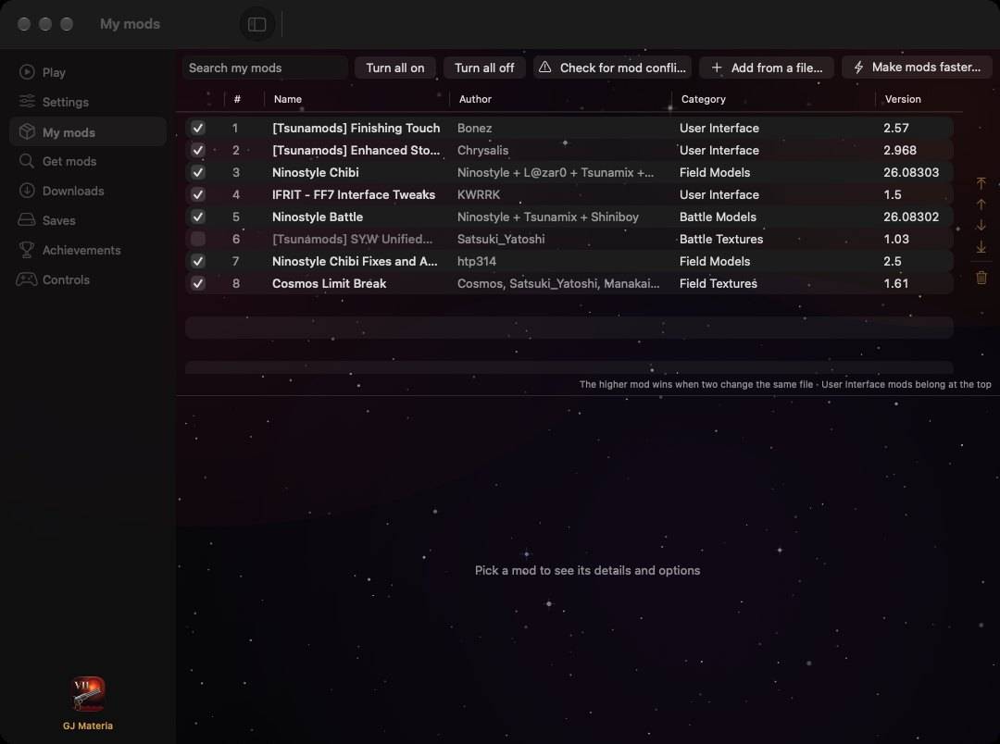
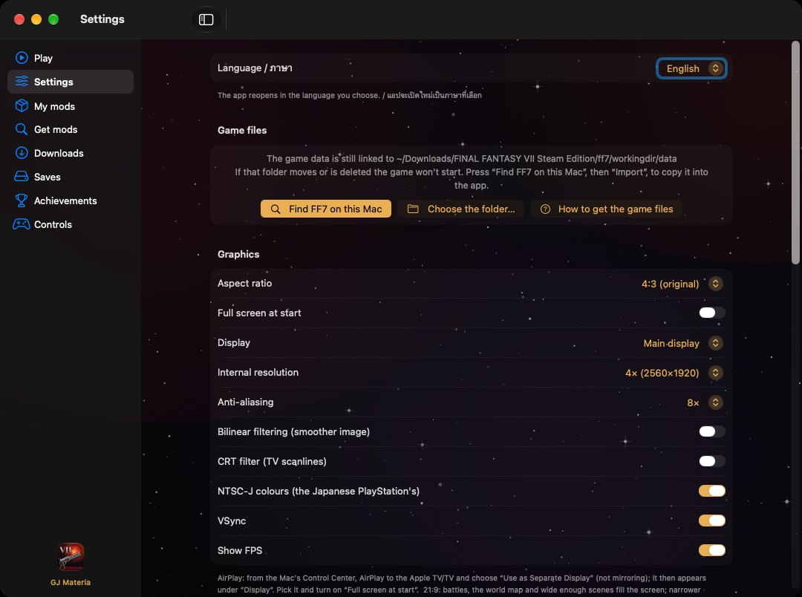
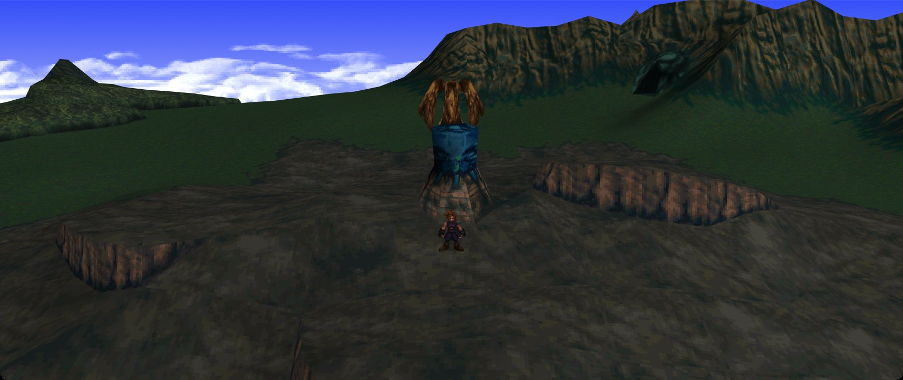
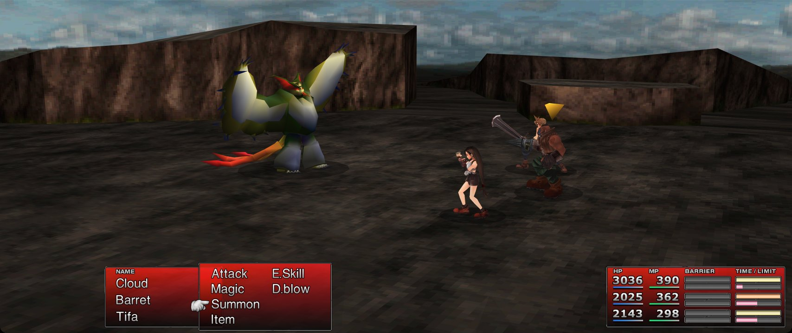
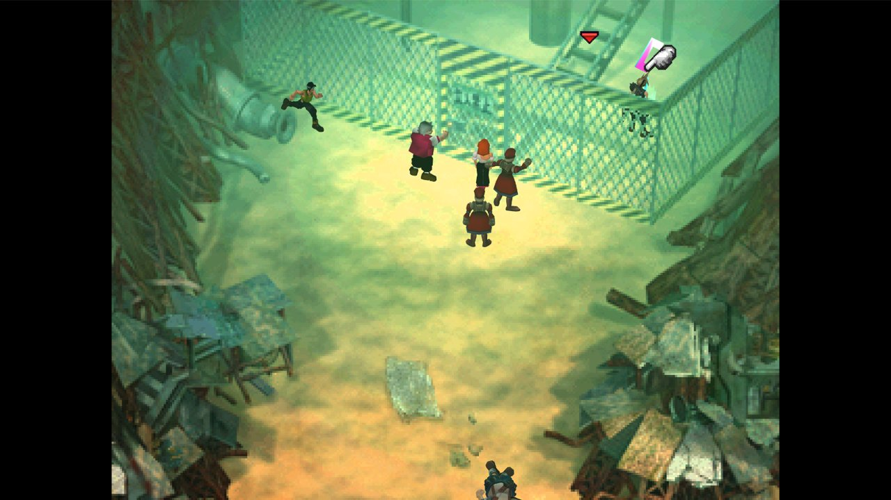
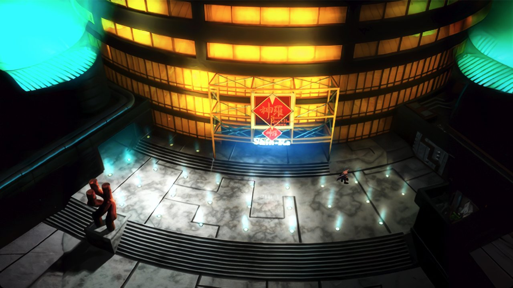
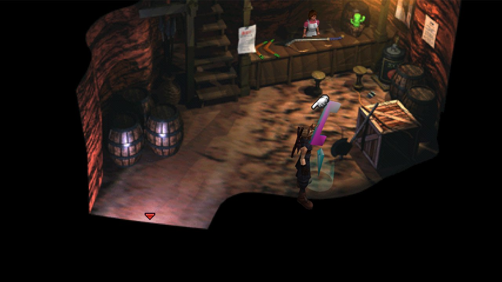
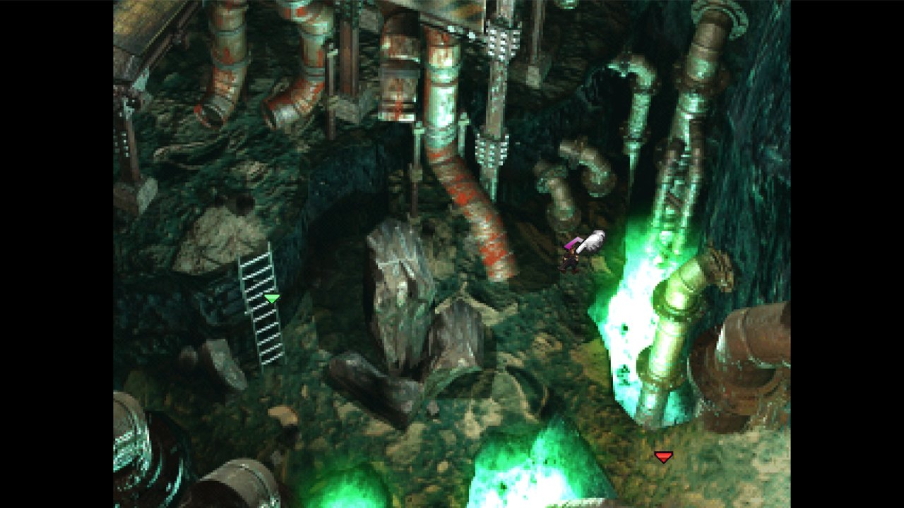

<p align="center"></p>

<h1 align="center">GJ Materia</h1>

<p align="center"><b>FINAL FANTASY VII (Steam) as a native Mac app, with a 7th Heaven-style mod manager.</b><br>
by <a href="https://github.com/goodjoeth">Good JOE</a> · the macOS port of
<a href="https://github.com/bhuiyah/ff7-recomp-android">FF7Recomp</a></p>

<p align="center">English · <a href="README.th.md">ภาษาไทย</a></p>

> **This repository contains no game code or data.** You need your own copy of FINAL FANTASY VII
> from Steam. The build script translates **your** `ff7_en.exe` and compiles it on **your** Mac;
> nothing derived from the game is ever published. Do not share the built app: it contains code
> derived from the game. Not affiliated with or endorsed by Square Enix.

<p align="center">
  
  
  
  
</p>


## What you get

- The game runs natively: no Wine, no CrossOver. The game's code was statically recompiled to C;
  graphics are FFNx on Metal. On Apple silicon it is a native arm64 app (no Rosetta); on Intel
  Macs, an Intel app.
- A launcher in English or Thai: settings (4:3, 16:9, 16:10, **21:9**, resolution, 30/60/120 FPS, CRT filter,
  NTSC-J colours, controller rumble, game boosters), 7th Heaven catalogs with downloads, a mod
  library with 7th Heaven's Configure Mod (option previews), save import/export (PC saves,
  DuckStation / RetroArch / ePSXe memory cards), save states, achievements (offline set, and
  Steam achievements by QR sign-in), playing on any display (an AirPlay display used as a
  separate display, a TV, a second monitor).
- Keyboard and controllers (Xbox, PlayStation, MFi). With a controller the launcher switches to a
  TV mode (big tiles, D-pad and A/B); Select+Start held for 2 seconds (or Cmd+L) leaves the game
  for the launcher. F1 (or Select+Triangle) shows the achievements over the game; Cmd+Shift+A
  opens them in a window of their own.
- iCloud saves: saves and save states in iCloud Drive/FF7Recomp, so every Mac on the Apple ID
  continues the same game (a backup before each Play, and a warning when another Mac is playing).
- Report a problem: one .zip with the logs, settings and mod list (no game files, no Steam
  sign-in), to attach to a bug report.

## Screen shapes

The same spot on the world map in each shape the game can take. Widescreen shows more of the world
instead of stretching it (FFNx's widescreen, extended here to 21:9).

| 4:3 (original) | 16:9 | 21:9 |
|:---:|:---:|:---:|
|  |  |  |

At 21:9 the mods' battle windows are laid out for 16:9; Settings chooses where the status window
(HP/MP) sits:

| Where 16:9 has it (default) | Halfway out | At the screen edge |
|:---:|:---:|:---:|
|  |  |  |

## Mods, side by side

The same saves with no mods, with one set and with another. Every mod comes from 7th Heaven's
catalogs and is installed from the launcher (Get mods > Download), with its options set in
My mods > Configure, as in 7th Heaven.

* **Vanilla**: no mods.
* **Set 1**: Finishing Touch, Enhanced Stock UI, Ninostyle Chibi (+ Fixes and Additions),
  Ninostyle Battle, SYW Unified Battle Textures, Cosmos Limit Break (widescreen field backgrounds).
* **Set 2**: Ninostyle HD (field models), Ninostyle Battle, Retextured World Textures, IFRIT
  interface tweaks, Wolfman avatars.

| Vanilla | Set 1 | Set 2 |
|:---:|:---:|:---:|
|  |  |  |
|  |  |  |
|  |  |  |
|  |  |  |

## Controller rumble

FINAL FANTASY VII on PC never vibrated, and FFNx's vibration covers FF8 only. GJ Materia adds it,
following what is on screen, on any controller the Mac can rumble (DualSense, DualShock 4, Xbox):

* **Battles**: a pulse on every hit, landed or taken, when its damage number comes up; strong
  magic, summons and Limit Breaks hit harder; a party member falling is a long, full rumble.
* **The field**: the screen's shakes (explosions, earthquakes, the plate falling) as strong as the
  shake, easing off when a scene leaves it running.
* **Minigames** (new, still being tuned): crashes, hits and landings in G-Bike, the chocobo races, snowboarding, Fort
  Condor, the submarine and the Speed Square, from their sound effects.
* Off, light or strong in Settings.

## Why it runs natively, and what that saves you

Wine, CrossOver, Whisky and the kits built on them run the Windows game as it is: every Windows
call goes through a re-implementation of Windows, Direct3D is translated to Metal on the fly
(often twice: Direct3D to Vulkan to Metal), and the 32-bit game needs Wine's 32-on-64-bit
bridge. That is where the stutters, freezes, black screens and broken movies come from, and
why each macOS or Wine update can break it.

GJ Materia does the translation once, ahead of time, on your Mac:

1. **The game's code becomes C.** A static recompiler (pcrecomp) reads your `ff7_en.exe` and
   writes every function of it as C source; clang compiles that into the app. Nothing is
   interpreted or emulated while you play.
2. **No Windows underneath.** The few Windows calls the game makes (files, timers, sound, input,
   windows) are answered by a small layer written for the Mac: files go straight to the disk,
   sound to Core Audio, controllers through Apple's Game Controller framework, the window is a
   normal Mac window.
3. **Graphics straight to Metal.** FFNx, the renderer the PC modding community uses, draws
   through bgfx's Metal backend: no Direct3D, no Vulkan, no translation layer.
4. **Mods without Windows.** 7th Heaven's catalogs, mod options and code patches (hext) are
   handled by the launcher itself; mods that patch the game's code can be lifted into the app too
   ("Make mods faster") so they run natively as well.

What that gives you: a steady 60 FPS with even frame pacing, no shader-translation hitches, quick
start-up, the Mac's own fullscreen, Retina resolution, rumble on Mac controllers, AirPlay to a TV,
iCloud saves, and nothing to configure (no bottles, prefixes or DLL overrides).

On Apple silicon the app is native arm64. The recompiled code expects the game's 32-bit memory
layout, which macOS keeps out of reach of arm64 apps (the lowest 4 GB), so GJ Materia gives the
game a 4 GB block of its own anywhere in memory and the code reaches it at an offset. Against the
earlier Intel build under Rosetta 2: the same steady 60 FPS, with about a fifth less CPU (30% vs
38% on a world-map walk). `FF7_ARCH=x86_64 bash tools/build_mac.sh` still builds the Intel app.

## First: your game files

You need FINAL FANTASY VII **bought on Steam** (the release sold today). Its files are the Windows
version; get them onto the Mac one of these ways:

- **A Windows PC:** Steam > right-click the game > Manage > Browse local files, and copy the
  whole `FINAL FANTASY VII Steam Edition` folder (about 3.5 GB) to the Mac (Downloads or an
  external drive is fine).
- **CrossOver or Whisky on the Mac:** install Windows Steam in a bottle, then FF7.
- **steamcmd on the Mac** (Valve's command-line Steam; it asks for your password and Steam Guard
  code in the Terminal):
  ```bash
  mkdir -p ~/steamcmd && cd ~/steamcmd
  curl -sqL "https://steamcdn-a.akamaihd.net/client/installer/steamcmd_osx.tar.gz" | tar zxf -
  ./steamcmd.sh +@sSteamCmdForcePlatformType windows +force_install_dir ~/FF7 +login YOUR_STEAM_LOGIN +app_update 3837340 validate +quit
  ```

The build script and the launcher find the folder by themselves in all of these places (and on
external drives); you can also point them at it.

## Install (the easy way)

1. Get your game files (above).
2. Download **GJ-Materia-Installer.zip** from [Releases](https://github.com/goodjoeth/gj-materia/releases),
   unzip it, and open **GJ Materia Installer**. The first time, macOS may say it can't check the
   developer: right-click the installer, choose **Open**, then **Open** again.
3. Press **Install**. It sets up Apple's Command Line Tools if missing (macOS asks you to
   confirm), fetches the build tools into its own folder (no Homebrew needed), finds your
   game, downloads this source and builds GJ Materia on your Mac (20-40 minutes the first time),
   then puts it in Applications.

The installer contains no game code and downloads none: the game's code is translated from your
own copy, on your Mac. Use the Mac's own drive or one formatted APFS / Mac OS Extended (exFAT
drives don't work for the build); about 15 GB free.

## Build (by hand)

Needs macOS 13 or later, about 15 GB free and 20-30 minutes the first time.

1. Get your game files (above).
2. Install the tools:
   ```bash
   xcode-select --install
   brew install cmake ninja
   python3 -m pip install --user capstone
   ```
3. Get this source and build:
   ```bash
   git clone https://github.com/goodjoeth/gj-materia.git
   cd gj-materia
   bash tools/build_mac.sh            # finds the game; or pass its folder
   ```
4. Open `build/macos/GJ Materia.app`. On the Play page, **Find FF7 on this Mac** and **Import**
   (once: the game files are copied into the app's folder), then **Play**.

Keep the source folder: **My mods > Make mods faster** re-lifts the enabled mods' code patches
from it (about 5-10 minutes) so they run natively.

Technical notes: [docs/MACOS.md](docs/MACOS.md). The Android version this is ported from:
[README_ANDROID.md](README_ANDROID.md).

## Roadmap

Done: everything listed under "What you get". Planned next, roughly in order:

* **More rumble**: a heartbeat at low HP, a pulse when a Limit Break is ready, patterns per
  element (fire crackle, thunder bursts, quake rumble), summons timed to their animations, the
  airship's and buggy's engines; DualSense light bar (party HP, Limit ready) and adaptive triggers.
* **Smoother scene changes**: load the next scene's files ahead (the last 50-150 ms hitches are
  file reads).
* **All mod code native**: the remaining code patches that still run in the interpreter.
* **21:9 battle windows without UI mods** (the game's own layout).
* **Updates from the app**: tell when a new GJ Materia is out and rebuild it with the installer.
* **A signed installer** (Apple Developer ID, so no right-click > Open the first time).
* **iPad and iPhone**: an app for sideloading (AltStore, SideStore, LiveContainer), built on the
  native Apple silicon version (done).
* **RetroAchievements online**, once RetroAchievements approves the app (the set works offline now).

Help and bug reports are welcome: the launcher's "Report a problem..." makes a .zip to attach.

## Thanks and credits

**A word from Good JOE.** I had given up on playing a modded FINAL FANTASY VII on my Mac: Wine and
CrossOver stuttered, froze and broke with every update. Then I found
[**FF7Recomp** by bhuiyah](https://github.com/bhuiyah/ff7-recomp-android), a static recompilation
of the PC game for Android. It showed me the game could run natively, without emulating Windows,
and that is what made me see a way to bring it to the Mac. GJ Materia is built on that work. Thank
you, bhuiyah.

None of this would exist without the people who have kept FF7 on PC alive for years:

* **[FF7Recomp](https://github.com/bhuiyah/ff7-recomp-android)** by bhuiyah: the recompiled game,
  its runtime and the Android port this Mac version grew from.
* **[FFNx](https://github.com/julianxhokaxhiu/FFNx)** by Julian Xhokaxhiu and its contributors: the
  renderer and the heart of modern FF7 on PC (widescreen, 60 FPS, mod textures, music, achievements).
* **[7th Heaven](https://github.com/tsunamods-codes/7th-Heaven)** by the Tsunamods team: the mod
  manager whose catalogs, mod format, options and code patches the launcher follows.
* **[pcrecomp](https://github.com/sp00nznet/pcrecomp)** by sp00nznet: the static recompiler.
* **The Qhimm and Tsunamods communities and every mod author**, among them Bonez (Finishing
  Touch), Chrysalis (Enhanced Stock UI), Ninostyle, Satsuki Yatoshi (SYW), KWRRK (IFRIT), the Cosmos
  team and the rest of the catalog's authors. Please support them.
* **The libraries**: bgfx (Branimir Karadžić), FFmpeg, SDL, rcheevos, capstone and the others in
  `tools/fetch_deps*.sh`.
* **Square Enix**, for FINAL FANTASY VII. Buy the game on Steam.

GJ Materia was put together by Good JOE, with an AI coding agent (Claude, in Claude Code) writing
the code under his direction, as FF7Recomp's Android version was. Licensed under the GNU GPL v3
(see LICENSE), as FF7Recomp and FFNx.
